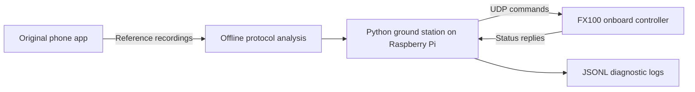

# FX-100 Drone Flight

**Reverse engineering a consumer drone's Wi-Fi protocol and building a Raspberry Pi control client.**

A hands-on robotics project by **Dean Gudgeon**. Starting with an undocumented RED5 FPV FX100, this project progressed from captured network traffic to validated packet framing, repeatable motor sequences and operator-reported enclosed takeoff, brief hover and landing.

The Raspberry Pi acts as a ground station. The drone's original onboard controller remains responsible for stabilisation. This is not a replacement flight controller or a production autonomous navigation system.

## Project highlights

- Captured and decrypted traffic from the original app on the project owner's drone.
- Validated an XOR integrity rule against **2,592 standard control packets** in the original dataset.
- Identified the correct client UDP port and correlated unlock, takeoff and landing commands with labelled app actions.
- Built Python clients with reply validation, status gates, JSONL logging, manual landing requests and bounded run times.
- Used failed and successful runs to distinguish network connectivity from command acceptance.
- Operator reported stable height and both manual and automatic landing during eight-second-version tests in a net enclosure.

**Evidence matters:** protocol and selected log results were inspected; enclosed-flight outcomes are operator reports. The latest eight-second flight logs were requested but had not been supplied for independent analysis when this repository was prepared. See [test evidence](docs/TEST_RESULTS.md).

## Architecture



## Hardware and software

| Component | Project setup |
|---|---|
| Aircraft | RED5 FPV FX100 |
| Ground station | Raspberry Pi 3, Raspberry Pi OS Bookworm |
| Drone connection | External 5 GHz Wi-Fi adapter, channel 36 |
| Development | Python 3 standard library, Windows laptop, SSH |
| Analysis | TShark/Wireshark, packet captures, JSONL logs |
| Planned interface | 3.5-inch 480 × 320 SPI touchscreen, Tkinter |

The touchscreen dashboard was an earlier simulation prototype. Its source is not included because it was not available in the reviewed project files. Live video, full telemetry and dashboard integration remain future work. No sponsorship or vendor endorsement is claimed.

## Explore without hardware

```bash
python3 -m unittest discover -s tests -v
python3 scripts/fx100_supervised_bench_8s.py
```

The second command displays instructions without transmitting. Scripts require explicit `--run` and a props-off acknowledgement to perform motor tests. Read [setup](docs/SETUP.md) and [limitations](docs/SAFETY.md) before any hardware use.

## Included scripts

| Script | Purpose |
|---|---|
| `fx100_probe.py` | Initial command/reply probe |
| `fx100_unlock_test.py` | Historical unlock and landing test |
| `fx100_takeoff_bench.py` | Historical two-second centred interval |
| `fx100_extended_bench_props_off.py` | Historical five-second interval |
| `fx100_land_validation.py` | Unlock-only manual landing validation |
| `fx100_supervised_bench.py` | Five-second interval with input and reply monitoring |
| `fx100_supervised_bench_8s.py` | Latest eight-second bench variant |

Historical scripts preserve the development trail; they do not all have the latest checks. No hardware-control behaviour was changed when packaging this repository.

## Current limitations

There is no verified altitude ceiling, collision avoidance, axis mapping, independent emergency stop, or demonstrated loss-of-link recovery. ENTER requests landing over the same Wi-Fi link; it cannot guarantee delivery. Eight seconds describes the centred-command interval, not eight seconds of verified stable hover. Reported flights do not certify these scripts for free flight.

## Engineering notes

- [Protocol findings and confidence](docs/PROTOCOL.md)
- [Test results and provenance](docs/TEST_RESULTS.md)
- [Development history](docs/DEVELOPMENT.md)
- [Setup and offline checks](docs/SETUP.md)
- [Safety and known implementation limits](docs/SAFETY.md)
- [Roadmap](docs/ROADMAP.md)

## Portfolio context

This project demonstrates practical protocol analysis, Raspberry Pi integration, state-aware Python programming and evidence-led hardware debugging. It sits alongside Dean's work on DUM-E, a separate robotics project. Potential collaborators can inspect the scripts and tests here without hardware access.

Raw captures, private network identifiers, Wi-Fi credentials, personal photographs and unredacted telemetry are intentionally excluded from publication. No open-source licence has been selected yet; public availability alone does not grant reuse rights.
