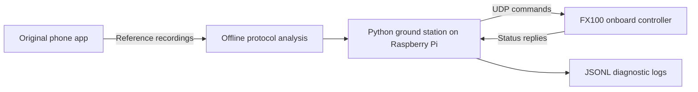

# FX-100 Drone Flight

**Reverse engineering a consumer drone's Wi-Fi protocol and building a Raspberry Pi control client.**

I started this project because I wanted to control my RED5 FPV FX100 from a Raspberry Pi instead of relying on its phone app. I didn't have a protocol specification to work from, so I captured the app's traffic and worked through how it communicated with the drone.

Since then, I've progressed from analysing packets to repeatable motor tests and short flights inside a net enclosure, including takeoff, a brief hover and landing. My longer-term goal is a touchscreen ground station with telemetry and more reliable automated control.

The Raspberry Pi acts as a ground station. The drone's original onboard controller remains responsible for stabilisation. This is not a replacement flight controller or a production autonomous navigation system.

## What I've achieved

- Captured and decrypted traffic between the original app and my own drone.
- Validated an XOR integrity rule against **2,592 standard control packets** in the original dataset.
- Identified the correct client UDP port and correlated unlock, takeoff and landing commands with labelled app actions.
- Built Python clients with reply validation, status gates, JSONL logging, manual landing requests and bounded run times.
- Used failed and successful runs to distinguish network connectivity from command acceptance.
- Tested the eight-second version in a net enclosure and observed it hold a stable height, then land both automatically and when I pressed ENTER.

I've documented which findings are supported by packet analysis and which come from what I observed during testing. My latest enclosed-flight results are based on those observations; the eight-second flight logs haven't yet been independently analysed. See [test evidence](docs/TEST_RESULTS.md) for the detail.

## Architecture



## Hardware and software

| Component | Project setup |
|---|---|
| Aircraft | RED5 FPV FX100 |
| Ground station | Raspberry Pi 3, Raspberry Pi OS Bookworm |
| Drone connection | External 5 GHz Wi-Fi adapter, channel 36 |
| Development | Python 3 standard library, Windows laptop, SSH |
| Analysis | TShark/Wireshark, packet captures, JSONL logs |
| Planned interface | 3.5-inch 480 × 320 SPI touchscreen, Tkinter |

I also started a touchscreen dashboard as a simulation prototype. I haven't included that source in this repository yet, and it isn't connected to the live control scripts. Live video, full telemetry and dashboard integration are still on my to-do list. This project isn't currently sponsored or endorsed by a hardware vendor.

## Explore without hardware

```bash
python3 -m unittest discover -s tests -v
python3 scripts/fx100_supervised_bench_8s.py
```

The second command displays instructions without transmitting. Scripts require explicit `--run` and a props-off acknowledgement to perform motor tests. Read [setup](docs/SETUP.md) and [limitations](docs/SAFETY.md) before any hardware use.

## Included scripts

| Script | Purpose |
|---|---|
| `fx100_probe.py` | Initial command/reply probe |
| `fx100_unlock_test.py` | Historical unlock and landing test |
| `fx100_takeoff_bench.py` | Historical two-second centred interval |
| `fx100_extended_bench_props_off.py` | Historical five-second interval |
| `fx100_land_validation.py` | Unlock-only manual landing validation |
| `fx100_supervised_bench.py` | Five-second interval with input and reply monitoring |
| `fx100_supervised_bench_8s.py` | Latest eight-second bench variant |

I've kept the earlier scripts so you can follow how the project developed. They don't all have the latest checks. I preserved their hardware-control behaviour when putting this repository together.

## Current limitations

I haven't yet verified an altitude ceiling, collision avoidance, axis mapping, an independent emergency stop or loss-of-link recovery. ENTER requests landing over the same Wi-Fi connection, so it can't guarantee delivery if that connection fails.

The eight-second setting is the centred-command interval, not a measurement of eight seconds in a stable hover. My successful tests are progress, but they don't make these bench scripts flight-ready.

## Engineering notes

- [Protocol findings and confidence](docs/PROTOCOL.md)
- [Test results and provenance](docs/TEST_RESULTS.md)
- [Development history](docs/DEVELOPMENT.md)
- [Setup and offline checks](docs/SETUP.md)
- [Safety and known implementation limits](docs/SAFETY.md)
- [Roadmap](docs/ROADMAP.md)

## Why I'm sharing this

I'm sharing the code and development notes so others can see how I approached the problem, what worked and what still needs improving. The project has given me practical experience with protocol analysis, Raspberry Pi networking, Python and debugging software against real hardware.

I'm also working on DUM-E, a separate robotics project. This repository is one example of the hands-on work I'm building alongside it. If you're interested in collaborating, the scripts, offline tests and technical notes are all here to explore.

I've left out raw captures, private network identifiers, Wi-Fi credentials, personal photographs and unredacted telemetry. I haven't selected an open-source licence yet, so public availability alone doesn't grant reuse rights.
